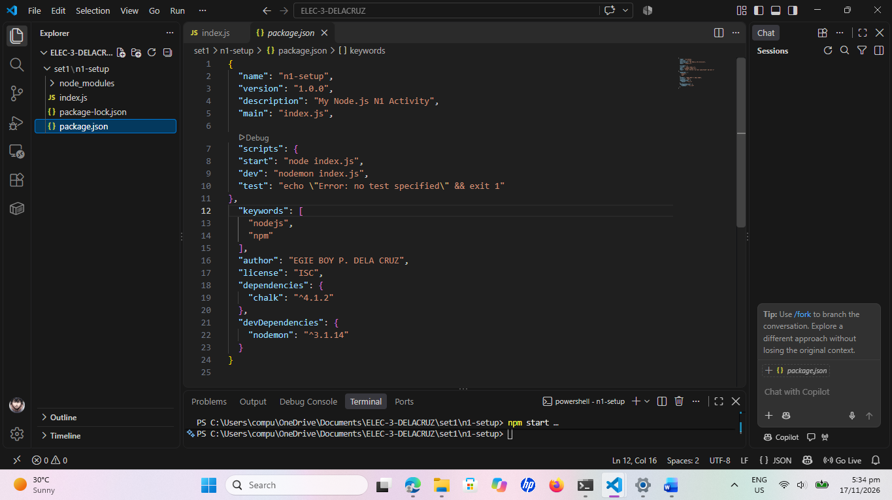

# ELEC 3 - Node.js Self-Paced Assignment

**Name:** EGIE BOY P. DELA CRUZ

**Section:** IV-BSIT A

**Course Code and Title:** ELEC 3 - Node.js

## Set 1 Activities

### N1 - Project Setup and Package Management

**Folder:** [N1 - Project Setup and Package Management](set1/n1-setup/)

Description: Demonstrates how to initialize a Node.js project, manage npm packages, configure package.json, and run a Node.js application.

**How to Run:**

```bash
cd set1/n1-setup
npm install
npm start
```

**Screenshots:**

#### 1. Node.js and npm Version Check


#### 2. Completed package.json



#### 3. Successful npm start Output


**Written Answers:** [N1 Answers](set1/n1-setup/N1_answers.docx)

---

### N2 - Modular Calculator

**Folder:** [N2 - Modular Calculator](set1/n2-calculator/)

Description: Demonstrates the use of Node.js modules by developing a modular calculator with five mathematical operations, formatted results, and error handling.

**Features:**

1. Addition
2. Subtraction
3. Multiplication
4. Division
5. Average
6. Division-by-zero error handling
7. Unknown-operation error handling
8. Operating system information using the built-in `os` module

**How to Run:**

```bash
cd set1/n2-calculator

node index.js add 12 8
node index.js subtract 12 8
node index.js multiply 12 8
node index.js divide 12 8
node index.js average 12 8
```

**Error Testing:**

```bash
node index.js divide 12 0
node index.js power 12 8
```

**Screenshots:**

#### 1. Calculator Operations


#### 2. Error Handling

