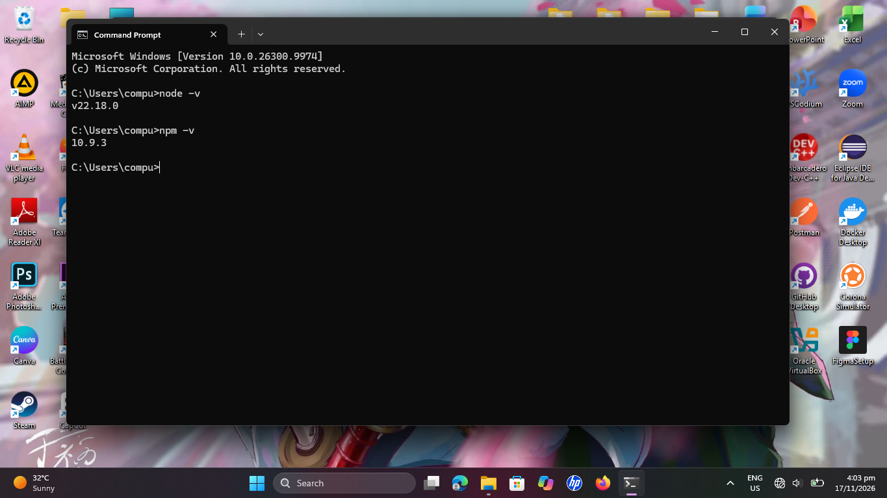
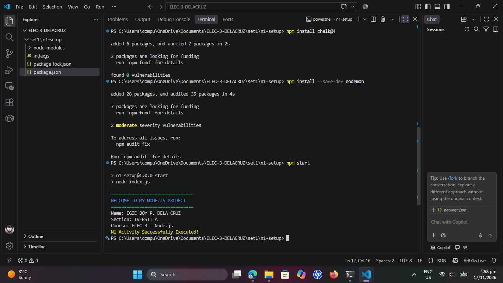
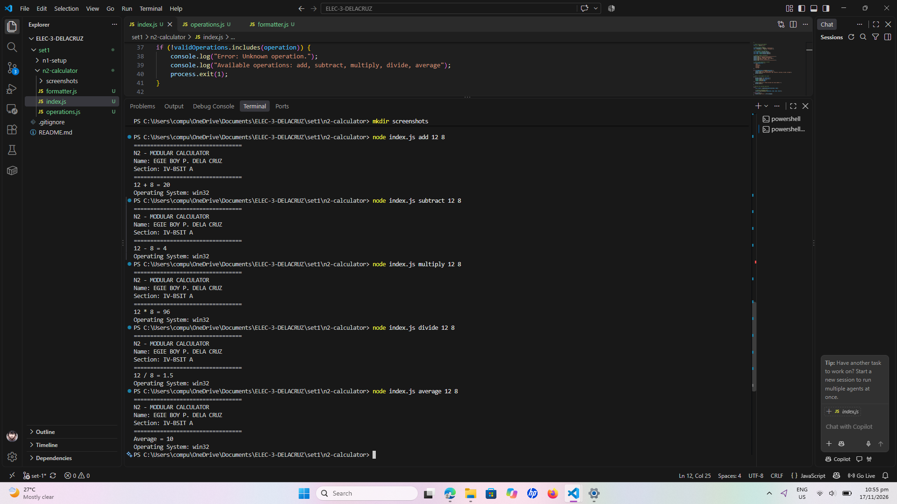
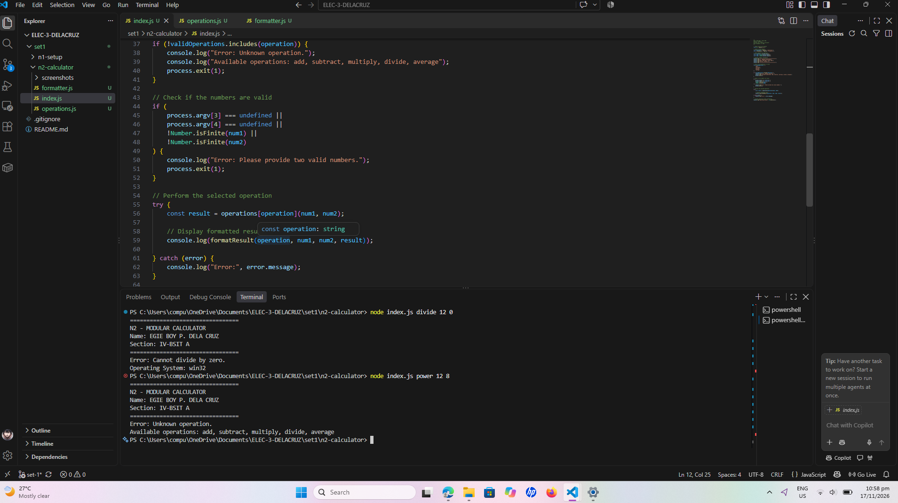
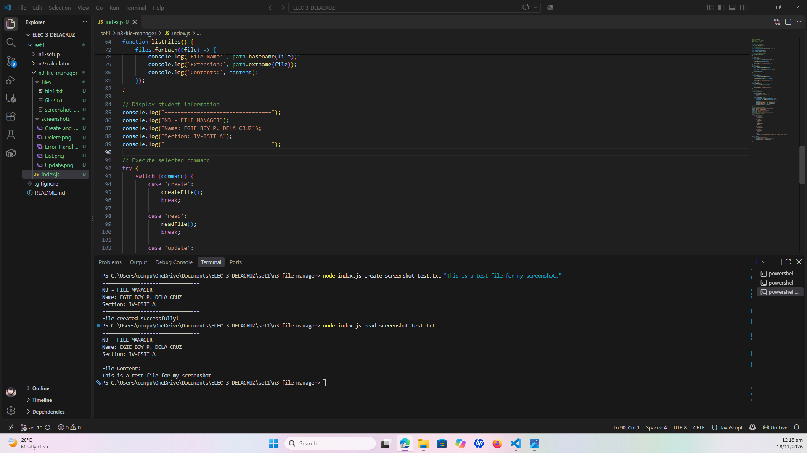
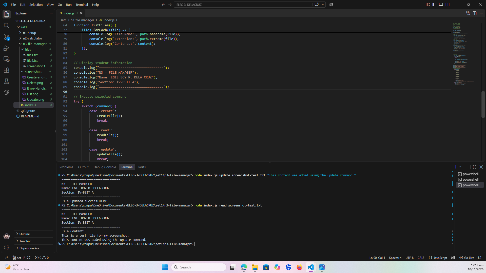
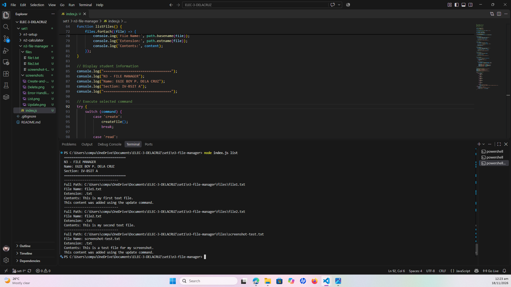
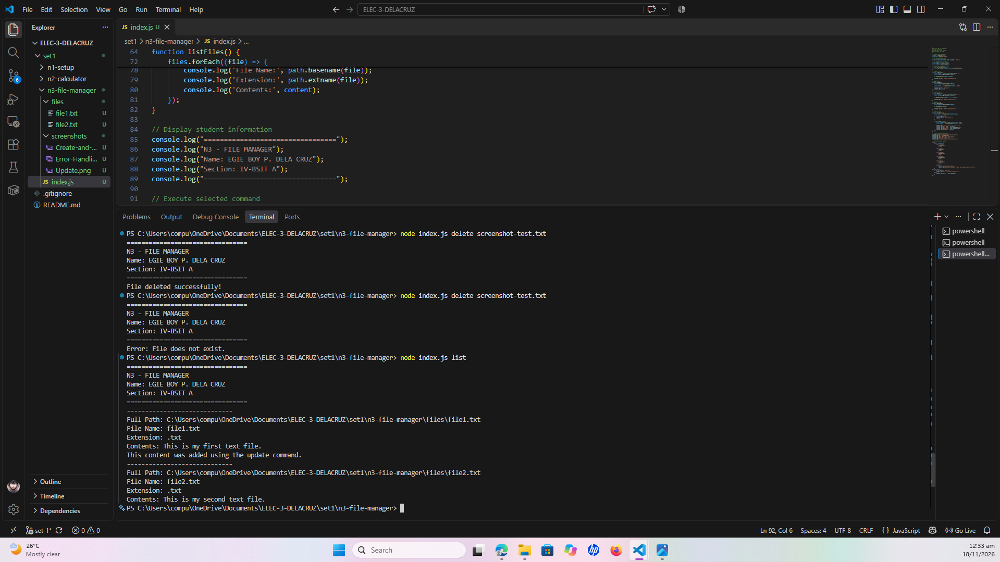
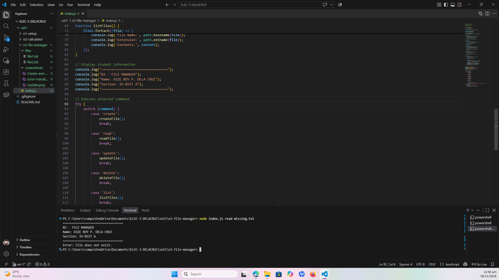

# ELEC 3 - Node.js Self-Paced Assignment

**Name:** EGIE BOY P. DELA CRUZ

**Section:** IV-BSIT A

**Course Code and Title:** ELEC 3 - Node.js

## Set 1 Activities

### N1 - Project Setup and Package Management

**Folder:** [N1 - Project Setup and Package Management](set1/n1-setup/)

Description: Demonstrates how to initialize a Node.js project, manage npm packages, configure package.json, and run a Node.js application.

**How to Run:**

```bash
cd set1/n1-setup
npm install
npm start
```

**Screenshots:**

#### 1. Node.js and npm Version Check



#### 2. Completed package.json


#### 3. Successful npm start Output



**Written Answers:** [N1 Answers](set1/n1-setup/N1_answers.docx)

---

### N2 - Modular Calculator

**Folder:** [N2 - Modular Calculator](set1/n2-calculator/)

Description: Demonstrates the use of Node.js modules by developing a modular calculator with five mathematical operations, formatted results, and error handling.

**Features:**

1. Addition
2. Subtraction
3. Multiplication
4. Division
5. Average
6. Division-by-zero error handling
7. Unknown-operation error handling
8. Operating system information using the built-in `os` module

**How to Run:**

```bash
cd set1/n2-calculator

node index.js add 12 8
node index.js subtract 12 8
node index.js multiply 12 8
node index.js divide 12 8
node index.js average 12 8
```

**Error Testing:**

```bash
node index.js divide 12 0
node index.js power 12 8
```

**Screenshots:**

#### 1. Calculator Operations



#### 2. Error Handling



---

## N3 - File Manager

**Folder:** [n3-file-manager](set1/n3-file-manager/)

### Project Description

A command-line file management application built with Node.js using the built-in `fs` and `path` modules. It allows users to manage text files stored in a dedicated `files` folder.

### Features

- Create new text files.
- Read the contents of existing files.
- Update files by appending new content.
- Delete existing text files.
- List all files with their full paths, file names, extensions, and contents.
- Display an error message when a requested file does not exist.

### Technologies Used

- Node.js
- JavaScript
- File System (`fs`) module
- Path (`path`) module
- Visual Studio Code

### How to Run

Open the terminal and navigate to the N3 folder:

```bash
cd set1/n3-file-manager
```

**Create a file:**
```bash
node index.js create notes.txt "Hello"
```

**Read a file:**
```bash
node index.js read notes.txt
```

**Update a file:**
```bash
node index.js update notes.txt "New content"
```

**List all files:**
```bash
node index.js list
```

**Delete a file:**
```bash
node index.js delete notes.txt
```

### Screenshots

**1. Create and Read — `Create-and-Read.png`**



**2. Update — `Update.png`**



**3. List — `List.png`**



**4. Delete — `Delete.png`**



**5. Error Handling — `Error-Handling.png`**



### Conclusion

This activity demonstrates how to use Node.js built-in modules to perform basic file management operations. It also demonstrates file path handling, command-line arguments, and basic error handling.