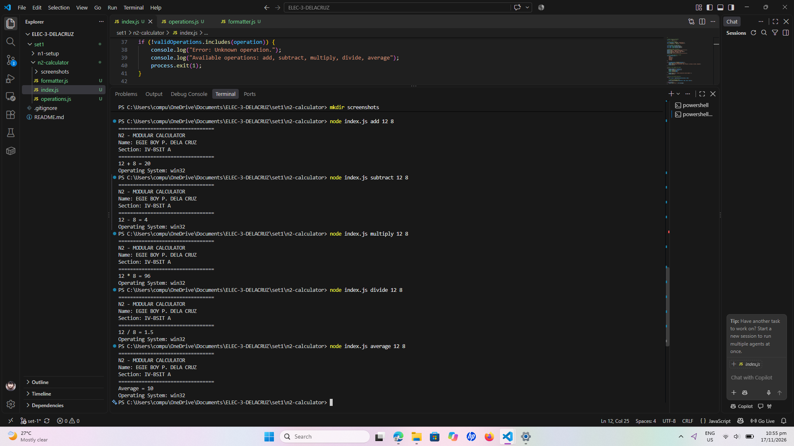
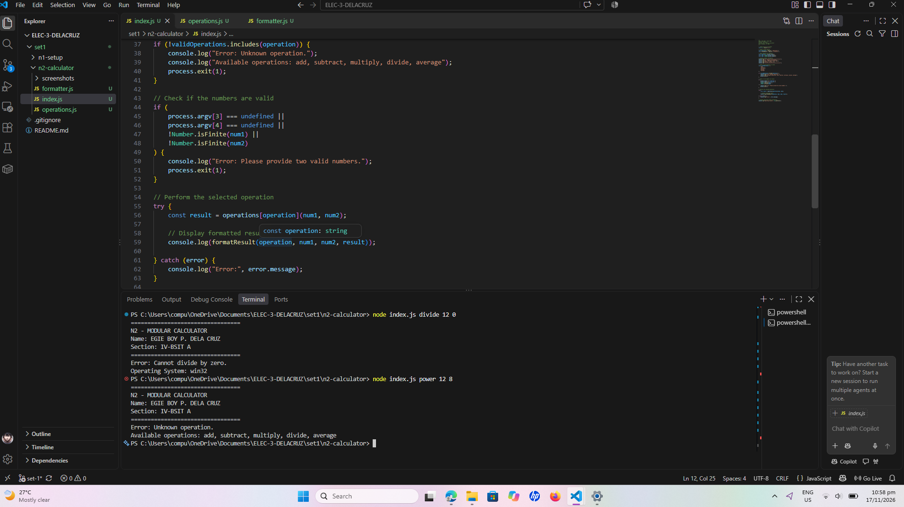

# N2 - Modular Calculator

**Name:** EGIE BOY P. DELA CRUZ

**Section:** IV-BSIT A

**Course:** ELEC 3 - Node.js

## Description

This activity demonstrates the use of Node.js modules by developing a simple modular calculator. It uses custom modules to perform mathematical operations and format calculation results.

## Project Files

- `index.js` - Main program that reads command-line arguments and executes the selected operation.
- `operations.js` - Contains the calculator functions: add, subtract, multiply, divide, and average.
- `formatter.js` - Formats the calculation results.
- `screenshots/` - Contains screenshots of the successful operations and error handling.

## Features

1. Addition
2. Subtraction
3. Multiplication
4. Division
5. Average
6. Division-by-zero error handling
7. Unknown-operation error handling
8. Operating system information using the built-in `os` module

## How to Run

Open the terminal inside the `n2-calculator` folder.

Example commands:

```bash
node index.js add 12 8
node index.js subtract 12 8
node index.js multiply 12 8
node index.js divide 12 8
node index.js average 12 8
```

## Error Testing

Test division by zero:

```bash
node index.js divide 12 0
```

Test an unknown operation:

```bash
node index.js power 12 8
```

## Screenshots

### Calculator Operations



### Error Handling

