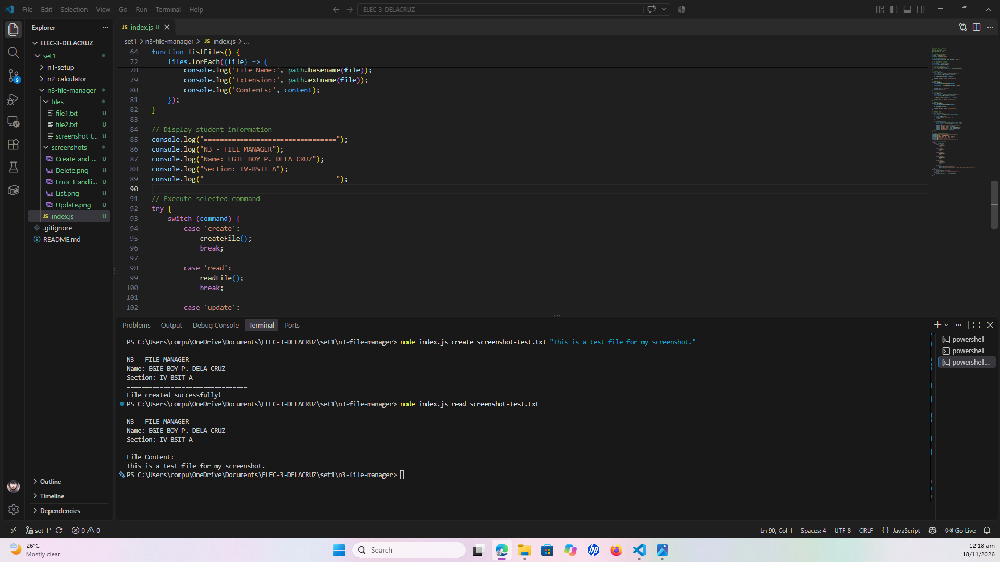
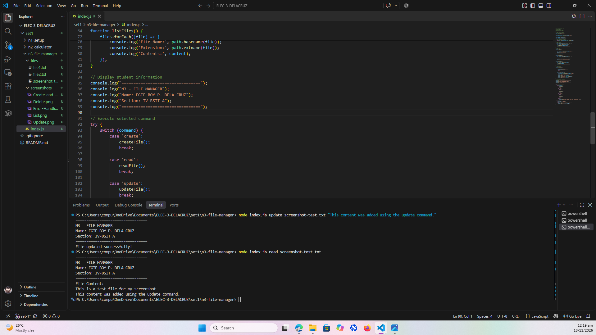
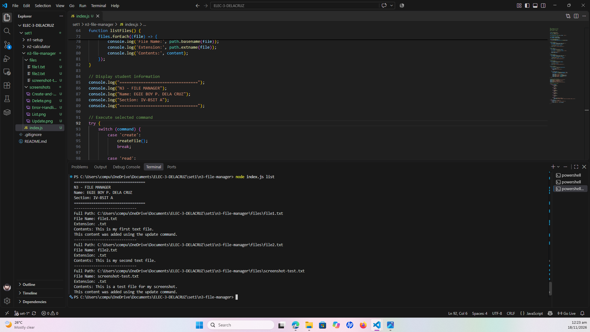
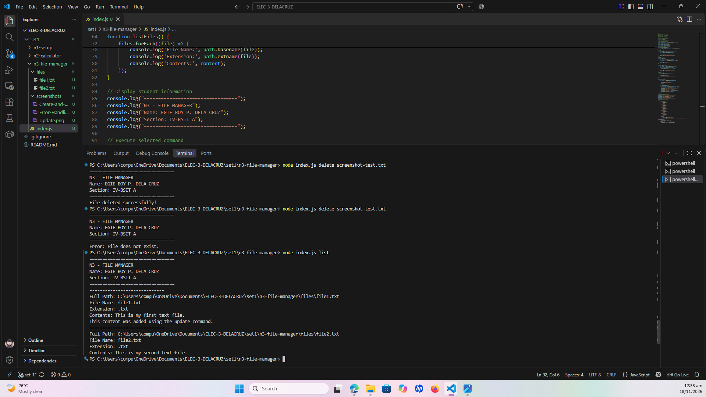
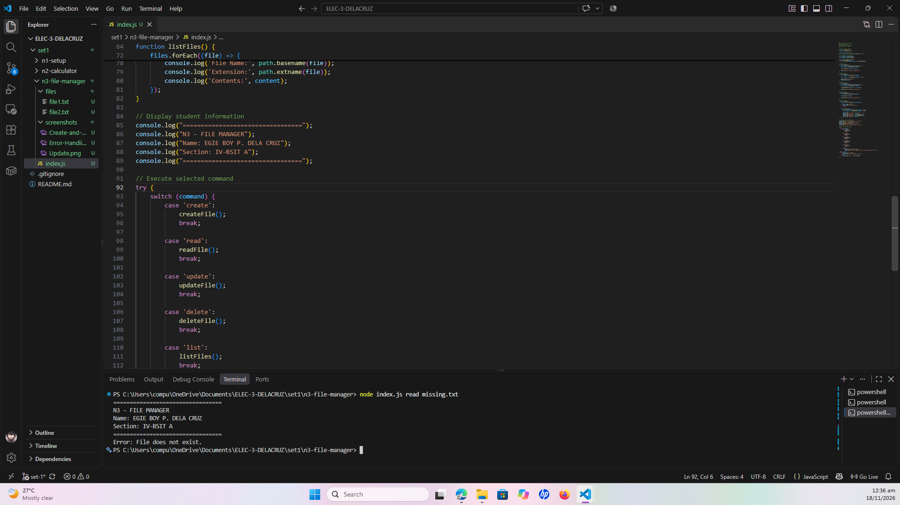

# N3 - File Manager

**Name:** EGIE BOY P. DELA CRUZ  
**Section:** IV-BSIT A  
**Course:** ELEC 3 - Node.js  
**Activity:** N3 - File Manager  
**Date:** November 18, 2026

## Project Description

The N3 File Manager is a simple command-line application built using Node.js. It uses the built-in `fs` and `path` modules to manage text files.

The application allows users to create, read, update, delete, and list text files stored in the `files` folder.

## Features

- Create new text files.
- Read the contents of existing files.
- Update files by appending new content.
- Delete existing files.
- List all files with their full paths, file names, extensions, and contents.
- Display an error message when a requested file does not exist.

## Project Structure

```text
n3-file-manager/
├── files/
│   ├── file1.txt
│   ├── file2.txt
│   └── file3.txt
├── screenshots/
│   ├── Create-and-Read.png
│   ├── Update.png
│   ├── List.png
│   ├── Delete.png
│   └── Error-Handling.png
├── index.js
└── README.md
```

## Commands

Run the following commands in the terminal from the `n3-file-manager` folder.

| Operation | Command |
|---|---|
| Create | `node index.js create notes.txt "Hello"` |
| Read | `node index.js read notes.txt` |
| Update | `node index.js update notes.txt "New content"` |
| Delete | `node index.js delete notes.txt` |
| List | `node index.js list` |

## Technologies Used

- Node.js
- JavaScript
- File System (`fs`) module
- Path (`path`) module
- Visual Studio Code

## Screenshots

### 1. Create and Read


### 2. Update


### 3. List Files


### 4. Delete


### 5. Error Handling


## Conclusion

This activity demonstrates how to use Node.js built-in modules to perform basic file management operations. It also demonstrates file path handling, command-line arguments, and basic error handling.